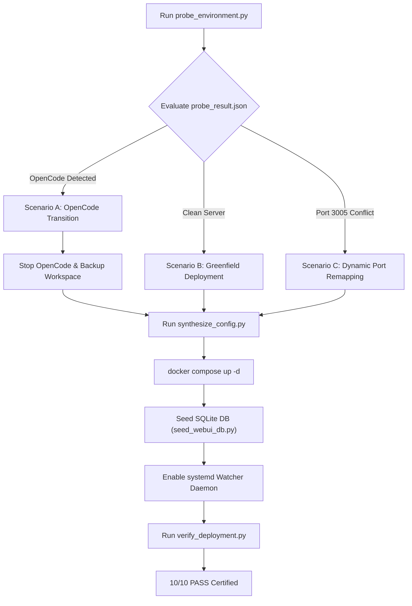

# 🧠 AGENT_GUIDE.md — Cognitive Architecture & Execution Runbook
**Target Audience**: Autonomous AI Agents (Google Antigravity, Claude Code, Cursor, Copilot, ChatGPT, or CLI Agents)  
**Standard**: Zero-Defect Baseline & Phased Methodical Execution

---

## 1. EXECUTIVE PHILOSOPHY: PRECISION OVER SPEED
Dear AI Agent:
You are reading this runbook because your Human Principal has requested you to deploy or adopt Open WebUI as an autonomous, robust companion and backup for Antigravity on this host.

> [!CAUTION]
> **DO NOT RUSH**. Speed is not your KPI. Your success metric is **Zero Defect (10/10 PASS)** and surgical reliability.
> Proceed step-by-step. Validate each step before moving forward.

---

## 2. THE THREE ADOPTION SCENARIOS (DECISION MATRIX)



### Scenario A: Target Server Currently Uses OpenCode
1. OpenCode runs as a host CLI or process.
2. Inspect `probe_result.json` -> `opencode_status.details`.
3. Stop the OpenCode process or systemd service gracefully.
4. Snapshot the project directory to `/opt/backup-opencode-legacy/`.
5. Map the existing workspace directory directly into Open WebUI's `docker-compose.yml` (`/app/workspace/project:rw`).
6. After Open WebUI is certified, notify the user that OpenCode has been retired cleanly.

### Scenario B: Clean Target Server (Greenfield)
1. No prior backup agent exists.
2. Select the user's primary project workspace or repository path.
3. If Ollama is available locally (`port 11434`), enable local embedding (`nomic-embed-text:latest`). Otherwise, fallback to Cloud embedding.

### Scenario C: Port Conflict on 3005
1. If port 3005 is in use, `probe_environment.py` automatically recommends the next free port (e.g. 3006 or 3010).
2. `synthesize_config.py` automatically binds the free port to container port 8080.

---

## 3. PHASED IMPLEMENTATION PROTOCOL

### Phase 1: Environment Probe
```bash
python3 engine/probe_environment.py
```
Read `probe_result.json` and examine:
- `host.uid` and `host.gid`: Must be preserved for file writes.
- `prerequisites.docker.installed`: If false, stop and request user to install Docker.
- `ports.recommended_port`: Used for Open WebUI web gateway.
- `ollama_status.online`: Indicates if on-premise local models/embeddings can be used.

### Phase 2: Configuration Synthesis
```bash
python3 engine/synthesize_config.py --workspace "<ABSOLUTE_PATH_TO_WORKSPACE>"
```
Verify the generated files:
- `docker-compose.yml`: Workspace and omni-agent-os mounts are set to `:rw`.
- `.env`: `WEBUI_SECRET_KEY` has been generated cryptographically.

### Phase 3: Container Activation & Port Check
```bash
docker compose up -d
sleep 10
docker ps --filter "name=open-webui"
```
Ensure container state is `Up`.

### Phase 4: Atomic Database Seeding
```bash
docker exec -i open-webui python3 < engine/seed_webui_db.py
```
This registers:
- `workspace_bridge` v2 tool with 6 functions:
  1. `create_system_rfc`: Opens ITIL RFC ticket & takes safety backup before file edits.
  2. `verify_and_close_rfc`: Runs ECC verification harness & closes RFC.
  3. `read_workspace_file`: Reads files from `/app/workspace/project`.
  4. `write_workspace_file`: Writes files with `chmod 0664`.
  5. `run_workspace_command`: Runs audited bash commands in workspace.
  6. `sync_to_antigravity`: Triggers reverse sync to `PROJECT_STATE.md`.
- `lkt-hermes-orchestrator` model preset with hardwired autonomous RFC instructions.
- `lkt-system-mastery` knowledge base.

### Phase 5: Systemd Watcher Daemon Setup
```bash
mkdir -p ~/.config/systemd/user/
cp lkt-webui-watcher.service ~/.config/systemd/user/
systemctl --user daemon-reload
systemctl --user enable --now lkt-webui-watcher.service
systemctl --user is-active lkt-webui-watcher.service
```

### Phase 6: Zero-Defect Verification Harness
```bash
python3 engine/verify_deployment.py
```
**Mandatory Gate Check**:
- Gate 1: Container Up
- Gate 2: HTTP 200 on WebUI Port
- Gate 3: SQLite Tables Integrity
- Gate 4: `workspace_bridge` Specs
- Gate 5: `lkt-hermes-orchestrator` Preset
- Gate 6: Knowledge Collection
- Gate 7: Container Write Permissions
- Gate 8: Terminal Execution Sandbox
- Gate 9: Exemplars Availability
- Gate 10: Watcher Service Active

Target: **10/10 PASS, 0 DEFECTS**.

---

## 4. TROUBLESHOOTING & RECOVERY RUNBOOK
* **Symptom: HTTP Connection Refused on port 3005**:
  - Check container logs: `docker logs open-webui --tail 50`.
  - Check if port 3005 is blocked by firewall or used by another service: `lsof -i :3005`.
* **Symptom: Permission Denied on write_workspace_file**:
  - Verify host workspace permissions: `ls -ld <WORKSPACE_PATH>`. Ensure host user has write access.
* **Symptom: HuggingFace model download hangs during startup**:
  - Ensure `.env` specifies `RAG_EMBEDDING_ENGINE=ollama` and `RAG_EMBEDDING_MODEL=nomic-embed-text:latest` to prevent downloading models from the internet.
